<div align="center">


<br />


[](https://fcnfabio.github.io/Portafolio-FabioCapacho/)
[](https://www.linkedin.com/in/fabio-capacho-749b953ab/)
[](mailto:contactofabiocapacho@gmail.com)
[](https://instagram.com/fcapacho_9)

</div>

<br />

<h2></h2>

Desarrollador de software de Bucaramanga, Colombia, en formación como **Técnico en Desarrollo de Software en Campuslands**. En seis proyectos en equipo **desarrollé interfaces con JavaScript modular, implementé capas de persistencia en Java, modelé bases de datos en MySQL y automaticé flujos con n8n e inteligencia artificial**.

Trabajo con ramas por desarrollador, *pull requests* y *conventional commits*, y **documento cada proyecto** para que otra persona pueda instalarlo, entenderlo y continuarlo.

| | |
|---|---|
| **Formación** | Técnico en Desarrollo de Software, Campuslands (2025 – actualidad) · Programa de Trading Algorítmico, Universidad del Rosario |
| **Idiomas** | Español (nativo) · Inglés (B1) · Francés (A1–A2) |
| **Intereses** | Arquitectura de software, automatización con IA, trading algorítmico, fútbol y ajedrez |


<h2></h2>

<div align="center">

</div>

Solo listo tecnologías que usé en los proyectos de este perfil.


<h2></h2>

| Proyecto | Descripción | Tecnologías |
|---|---|---|
| [**TechNova IT Helpdesk**](https://github.com/SantiSarmiento11/TechNova) | Desarrollé el front-end "Lumina Desk" de una plataforma de soporte TI: implementé sesión con JWT, control de acceso por roles y un dashboard de métricas conectado a un backend en Spring Boot. | Java 21 · Spring Boot · PostgreSQL · JavaScript |
| [**AMB Reporta**](https://github.com/SantiSarmiento11/Proyecto-n8n) ([demo](https://proyecto-n8n.vercel.app)) | Construí la interfaz web de un portal ciudadano de reportes de infraestructura e integré su formulario con mapa interactivo a flujos de n8n que analizaron imágenes con IA y notificaron por Telegram. | HTML · CSS · JavaScript · n8n · Leaflet |
| [**RapidExpress**](https://github.com/Alter-09/RapidExpress) | Diseñé e implementé la capa de persistencia de un sistema de logística: modelé las entidades del dominio y programé los DAOs en JDBC para flota, conductores, paquetes y rutas. | Java 17 · MySQL · Maven · JUnit 5 |
| [**Agents Mega Music App**](https://github.com/SantiSarmiento11/Proyecto-HTML-CSS-C) | Maqueté el flujo de compra de una tienda de música: desarrollé las vistas de carrito, checkout y confirmación con HTML5 semántico y CSS3 modular. | HTML5 · CSS3 |
| [**CampusBuild**](https://github.com/SantiSarmiento11/PROYECTO-JS-DASHBOARD) | Implementé el módulo de actividades e hitos de una aplicación de gestión de obras y lo integré con el cronograma mensual mediante Web Components. | JavaScript ES Modules · Web Components |
| [**Sistema de Gestión de Coworking**](https://github.com/Fcnfabio/Sistema_Coworking) | Modelé la base de datos de un coworking en MySQL: diseñé 14 tablas con claves foráneas y vistas, y coordiné la integración del trabajo de un equipo de cuatro personas. | MySQL 8 |

Otros trabajos: [**Portafolio personal**](https://github.com/Fcnfabio/Portafolio-FabioCapacho) ([ver online](https://fcnfabio.github.io/Portafolio-FabioCapacho/)) y [**Gestor de Gastos Personales**](https://github.com/Fcnfabio/Proyecto_PythonCapachoFabio), una aplicación de consola en Python.

### Detalle de cada proyecto

<details>
<summary><b>TechNova IT Helpdesk</b> · gestión de incidentes y soporte técnico</summary>

<br>

**Problema:** el registro informal de incidentes por correo y mensajes no ofrecía trazabilidad ni control de tiempos de respuesta.

**Qué hace el sistema**
- Ciclo de vida del ticket con máquina de estados estricta: Abierta, Asignada, En proceso, Resuelta y Cerrada.
- SLAs por prioridad: crítica 1 h, alta 2 h, media 8 h, baja 24 h.
- Tres roles (Admin, Técnico y Usuario) con autenticación JWT y control de acceso por roles.
- Auditoría de cada cambio de estado y dashboard de métricas.

**Lo que hice**
- Desarrollé el front-end "Lumina Desk" como SPA en JavaScript modular.
- Implementé el cliente HTTP con interceptor JWT y el manejo de sesión y permisos.
- Construí las vistas de dashboard, tickets, detalle con transiciones y reportes.
- Escribí las pruebas unitarias del frontend.

**Arquitectura:** backend en capas (`controller`, `service`, `repository`, `model`, `security`) y SPA separada por responsabilidad (`api`, `session`, `ui` y páginas).

**Documentación:** API REST documentada con Swagger/OpenAPI, especificación de requisitos (ERS) y [video demo](https://drive.google.com/file/d/1faXvxssYdiEFrVovwQjpUbP7ON19MeMl/view?usp=sharing).

**Equipo:** cinco personas, con líder, arquitectura, frontend y API.

[Ver repositorio →](https://github.com/SantiSarmiento11/TechNova)

</details>

<details>
<summary><b>AMB Reporta</b> · portal ciudadano con automatización en n8n</summary>

<br>

**Problema:** los ciudadanos del Área Metropolitana de Bucaramanga no tenían un canal ágil para reportar daños en infraestructura pública ni para consultar su estado.

**Cómo funciona**
1. El ciudadano llena el formulario con sus datos, el tipo de daño, una foto y la ubicación en un mapa.
2. Un webhook de n8n recibe el reporte y un agente de IA analiza la imagen y la descripción.
3. El reporte se guarda en Google Sheets y el equipo recibe una notificación por Telegram.
4. El ciudadano consulta el estado en la web o desde un bot de Telegram.

**Lo que hice**
- Desarrollé el formulario de reporte con mapa interactivo Leaflet.
- Construí la consulta de seguimiento de reportes.
- Integré el frontend con los webhooks del flujo de n8n.

**Despliegue:** frontend publicado en [proyecto-n8n.vercel.app](https://proyecto-n8n.vercel.app). El flujo completo está exportado en `Workflow.json`.

[Ver repositorio →](https://github.com/SantiSarmiento11/Proyecto-n8n)

</details>

<details>
<summary><b>RapidExpress</b> · gestión de flotas, rutas y paquetería</summary>

<br>

**Problema:** la operación logística se llevaba en hojas de cálculo, sin control de capacidad de vehículos ni seguimiento de paquetes.

**Qué hace el sistema**
- Valida el sobrecupo: el peso de los paquetes no puede superar la capacidad del vehículo.
- Controla los estados del paquete: En bodega, Asignado a ruta, En tránsito, Entregado y Devuelto.
- Audita las operaciones críticas en base de datos y en archivo de log.
- Genera reportes operativos.

**Lo que hice**
- Modelé las entidades del dominio y las enumeraciones de estado.
- Programé los DAOs en JDBC con `PreparedStatement` para vehículos, conductores, paquetes, rutas, mantenimientos y auditoría.
- Escribí pruebas de las entidades.
- Integré mi trabajo mediante pull requests desde mi rama propia.

**Arquitectura:** MVC, DAO y capa de servicio, con base de datos MySQL normalizada, restricciones `CHECK`, vistas y diagrama entidad-relación documentado. Pruebas con JUnit 5.

[Ver repositorio →](https://github.com/Alter-09/RapidExpress)

</details>

<details>
<summary><b>Agents Mega Music App</b> · streaming y tienda digital</summary>

<br>

**Problema:** unir en un solo flujo la escucha de música y la compra de álbumes: catálogo, detalle, reproductor, carrito, pago y confirmación.

**Calidad del frontend:** HTML5 semántico, CSS3 modular con variables de diseño (*design tokens*), enfoque *mobile-first* y atributos ARIA, sin frameworks ni JavaScript.

**Lo que hice**
- Desarrollé las vistas `cart.html`, `checkout.html` y `success.html`.
- Estilicé el flujo de pago con `checkout.css`.
- Trabajé en mi rama `DevFabio` dentro de un equipo con una rama por desarrollador.

[Ver repositorio →](https://github.com/SantiSarmiento11/Proyecto-HTML-CSS-C)

</details>

<details>
<summary><b>CampusBuild</b> · gestión de proyectos de construcción</summary>

<br>

**Problema:** registrar proyectos, actividades, hitos y recursos humanos, y visualizar un cronograma mensual y estadísticas, sin necesidad de backend.

**Arquitectura:** SPA en JavaScript ES Modules con Web Components nativos, capa de persistencia aislada (`storage.js`) y un módulo por responsabilidad (proyectos, actividades, recursos y calendario).

**Lo que hice**
- Implementé el módulo de actividades e hitos.
- Integré las actividades con el cronograma mensual.
- Programé el arranque de la aplicación (`app.js`) y su registro de Web Components.
- Trabajé en mi rama `DevFabio` e integré mis cambios con pull requests.

[Ver repositorio →](https://github.com/SantiSarmiento11/PROYECTO-JS-DASHBOARD)

</details>

<details>
<summary><b>Sistema de Gestión de Coworking</b> · base de datos MySQL</summary>

<br>

**Problema:** modelar y automatizar la operación de un coworking: usuarios, empresas, membresías, reservas de espacios, pagos, facturación, accesos y auditoría.

**Contenido:** scripts en carpetas numeradas (DDL, DML, consultas, funciones, procedimientos, triggers, eventos programados, roles y documentación) y cinco roles con permisos diferenciados.

**Lo que hice**
- Diseñé el modelo relacional y el DDL: 14 tablas con claves foráneas y vistas.
- Coordiné el repositorio de un equipo de cuatro personas.
- Revisé e integré los pull requests de mis compañeros.

[Ver repositorio →](https://github.com/Fcnfabio/Sistema_Coworking)

</details>


<h2></h2>

| Proyecto | Arquitectura o patrón | Prácticas aplicadas |
|---|---|---|
| TechNova | Capas (controller, service, repository, model) y máquina de estados | JWT y RBAC, API documentada con Swagger, ERS y pruebas unitarias en el frontend |
| RapidExpress | MVC, DAO y Service Layer | Acceso a datos con `PreparedStatement`, pruebas con JUnit 5 y auditoría |
| CampusBuild | Módulos ES, Web Components y capa de persistencia | Separación de responsabilidades por archivo y validaciones de negocio |
| AMB Reporta | Frontend desacoplado y automatización por webhooks | Flujo exportado (`Workflow.json`) y configuración centralizada |
| Coworking | Modelo relacional normalizado con lógica en la base de datos | Triggers, procedimientos, eventos y roles con mínimo privilegio |
| Music App | Design tokens CSS y HTML semántico | Mobile-first y accesibilidad con ARIA |

Aplico la **separación de responsabilidades**, de modo que cada clase o módulo cumple una sola función y depende de capas bien definidas, en línea con los principios SOLID.


<h2></h2>

- **Una rama por desarrollador** (`DevFabio`, `DevSantiago` y similares), integradas a `main` o `test` mediante pull requests.
- **Flujo de ramas:** `main` (estable), `develop` (integración) y `feature/*` (nuevas funcionalidades).
- **Roles definidos** en cada equipo, por ejemplo frontend, API y arquitectura en TechNova, y README con la distribución de responsabilidades.
- **Revisión de código:** revisé e integré pull requests de compañeros en el proyecto de Coworking.


<h2></h2>

Mis commits siguen el formato `tipo: :gitmoji: título`, con una descripción cuando el cambio la necesita.

```text
feat: :sparkles: Agregar módulo de actividades e hitos

Permite crear actividades con responsable, fechas y estado
y las conecta con el cronograma mensual.
```

| Tipo | Gitmoji | Uso |
|---|---|---|
| `feat` | `:sparkles:` | Nueva funcionalidad |
| `fix` | `:bug:` | Corrección de errores |
| `docs` | `:memo:` | Documentación |
| `style` | `:art:` | Cambios visuales o de formato |
| `refactor` | `:recycle:` | Reestructuración sin cambiar el comportamiento |
| `test` | `:white_check_mark:` | Pruebas |
| `chore` | `:wrench:` | Tareas de mantenimiento |

Versiono los proyectos con SemVer (`vMAYOR.MENOR.PARCHE`).


<h2></h2>

| Proyecto | Enlace |
|---|---|
| Portafolio personal | [fcnfabio.github.io/Portafolio-FabioCapacho](https://fcnfabio.github.io/Portafolio-FabioCapacho/) |
| AMB Reporta | [proyecto-n8n.vercel.app](https://proyecto-n8n.vercel.app) |


<h2></h2>

<div align="center">


</div>


<h2></h2>

- **Correo:** [contactofabiocapacho@gmail.com](mailto:contactofabiocapacho@gmail.com)
- **LinkedIn:** [Fabio Capacho](https://www.linkedin.com/in/fabio-capacho-749b953ab/)
- **Instagram:** [@fcapacho_9](https://instagram.com/fcapacho_9)
- **Portafolio:** [fcnfabio.github.io/Portafolio-FabioCapacho](https://fcnfabio.github.io/Portafolio-FabioCapacho/)

<br />


